

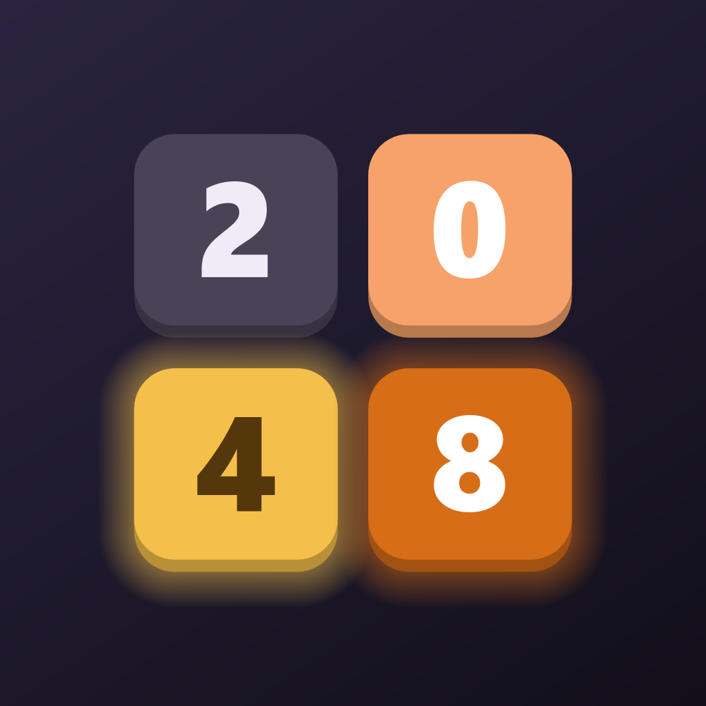

# 2048 Merge

**Offline number puzzle for Android: no ads, no network, no tracking**
 
**Числовая головоломка для Android: без рекламы, без интернета, без трекинга**

### [⬇️ RuStore](https://www.rustore.ru/catalog/app/com.mahiron.merge2048) · [⬇️ GitHub Releases](https://github.com/Mahiron-hq/2048/releases/latest)

**[English](#-english)** · **[Русский](#-русский)** · **[Screenshots / Скриншоты](#-screenshots--скриншоты)**

---

## 🇬🇧 English

2048 Merge is the classic sliding-tile puzzle. A swipe moves every tile one way, and equal numbers merge into one when they collide. Play on a 3×3, 4×4, 5×5 or 6×6 board. There is no hard finish: play goes on past 2048. A game ends only when the board is full and no moves are left.

All graphics and sound effects are generated by code at runtime, and an original soundtrack, **"2048 Quiet Tiles"**, plays underneath. Move hints come from the game's own search engine. The arm64 APK is about 30 MB.

### Features

| | |
|---|---|
| 🎯 **Faithful 2048 rules** | One merge per tile per move, spawns 2 (90%) or 4 (10%) |
| 🔲 **Four board sizes** | 3×3, 4×4, 5×5 and 6×6, picked next to "New game". Records are kept per size, overall and **without help** (no undo, no hints) |
| 💡 **Move hints, three strengths** | The bulb suggests a move by nudging the tiles that way. **Simple** answers at once, **Medium** thinks for up to a second, **Smart** goes as deep as the phone manages in up to 15 seconds and stops early once its answer is settled. Tapping again or moving calls the search off |
| ↩️ **Undo, your way** | 0 to 5 steps back (default 1). The move plays backwards. The "No moves left" card can undo the losing move |
| 📊 **Statistics** | Games played, average score, best score, best without help, best tile, longest game, total moves and time played, overall or per board size. A game counts once it is lost, or after ten moves when you start a new one |
| 💾 **Saves that survive** | Everything is saved after every move. Writes are atomic, the previous save is kept as a backup, and a damaged file is set aside, never overwritten |
| 🔁 **Your data, your choice** | Save progress to a file and load it on another phone; reset statistics, records or both, for every size or one, behind two confirmations |
| 🎉 **Milestones** | 128 / 256 / 512 / 1024 / 2048 / … bring a banner, confetti and a chime, once per game |
| 📱 **Phones and tablets, any orientation** | Portrait and landscape layouts for every screen |
| 🌗 **Themes: auto, light and dark** | Auto follows the phone, even while you play; both themes are built on the same color roles, and text keeps at least 4.5:1 contrast |
| ♿ **Text size and reduced motion** | Text follows the phone's font size (up to 130%) or a fixed 100/115/130%; Reduce motion keeps the tiles sliding and turns confetti, rings, pulses and bounces into plain fades |
| 🖼️ **Graphics quality** | Low (720p), medium (1080p) or high (up to 2K), never above the screen's own resolution |
| 🌐 **English & Russian** | Picked from the system language (Russian also for neighbouring countries), switchable in settings |
| 📳 **Haptics that grow with the tiles** | Merging 2s is silent; from 4s up to 65536 every merge is a step stronger, and a lost game ends with soft waves. Follows the phone's own vibration settings |
| 🎵 **Original music** | "2048 Quiet Tiles"; separate 7-step volume for music and effects |
| 🔋 **Battery friendly, 60–144 Hz** | Animation runs as fast as the screen allows or at a cap you choose; a still screen redraws nothing and lets the display drop to its idle rate, and the display sleeps two minutes after your last touch |
| 🔒 **No extra permissions** | The only permission is vibration. No `INTERNET`, ads, analytics or purchases. The About screen lists every license |

### Install

- **RuStore:** [2048 Merge](https://www.rustore.ru/catalog/app/com.mahiron.merge2048) – updates arrive by themselves.
- **GitHub:** open the [latest release](https://github.com/Mahiron-hq/2048/releases/latest) and download an APK:
  - **`2048-Merge-vX.Y.Z-arm64-v8a.apk`** for virtually every phone and tablet from recent years. If unsure, take this one.
  - **`…-armeabi-v7a.apk`** for older 32-bit devices where the first one won't install.
  - **`…-universal.apk`** contains both (it is the file RuStore gets), at twice the size.

  Open the file on your device and allow installs from that source if Android asks. From a computer: `adb install -r 2048-Merge-vX.Y.Z-arm64-v8a.apk`.

The `.aab` file in the release is the bundle for Google Play; it does not install on a phone directly. Every release carries checksums and a signed provenance attestation, see [SECURITY.md](SECURITY.md).

> Requires Android 8.0 (API 26) or newer. New versions install over old ones and keep your records, statistics and settings.

### How to play

- **Swipe** in any direction to move all tiles. Equal numbers merge, and their sum is added to your score.
- Pick the **board size** with the button left of **New game** in the menu.
- **The bulb** shows a suggested move: the tiles lean that way twice. The move itself is yours to make. Hold the bulb to bring up a choice of strengths and switch it right there, or set it in **Settings → Game settings**.
- **Undo** plays the last move backwards. The number on the button shows how many steps you can still take back.
- Android **Back** goes to the menu, and from the menu sends the game to the background. Your game is saved either way.
- **Settings:** sound and music with volume sliders, vibration, theme, language, text size, reduced motion, graphics quality, FPS counter and limit; hints and their strength, undo depth; progress file, resets; About.

### Performance and battery

Measured with version 1.3.1 on an **Infinix NOTE 50 Pro** (Android 16, MediaTek MT6789, Mali-G57, screen at 120 Hz) and a **Redmi Note 10S** (Android 13, MediaTek MT6785, Mali-G76, 60 Hz). CPU time is the game's share of one core; every phase, the battery estimate, memory and the method are in [docs/PERFORMANCE.md](docs/PERFORMANCE.md).

| | Infinix: frames/s, CPU | Redmi: frames/s, CPU |
|---|---|---|
| Menu, untouched | 0, 7% | 0, 8% |
| New board, untouched | 30, 52% | 30, 63% |
| Playing, 2 moves a second | 103, 86% | 55, 75% |
| FPS counter on, no cap | 120, 100% | 60, 87% |
| … cap 60 | 60, 77% | 60, 88% |
| … cap 30 | 30, 50% | 30, 62% |

- **A still screen costs almost nothing.** It draws no frames, and two seconds after your last touch the game lets the display drop to its idle rate (the Infinix goes from 120 to 60 Hz, as it does for the system's own apps) and wakes less often. Most of what remains is the music. The breathing arrows on a new board draw at 30 frames a second, not at the screen's 60–120.
- **Battery:** Android's own estimate on the Redmi puts an hour of play at about 90 mAh at minimum brightness, under 2% of its battery, and 87% of that is the screen.
- **Hints:** Simple answers in about 10 ms. Medium takes a median of 0.1–0.85 s and at most about 0.9 s: it stops early when the next level of depth cannot finish within its second. Smart takes from a fraction of a second up to its 15-second cap, a median of 4–13 s. The Rust engine is about 40 times faster than the old GDScript solver of 1.3.0 on one core.
- **Size:** the arm64 APK is 29 MB to download and 99 MB installed; the game reaches its first frame in about 0.4 s (Infinix) and 0.75 s (Redmi). Memory: about 245–270 MB.
- The frame cap paces evenly when the screen's rate is a multiple of it: 60 on 120 Hz screens, 30 everywhere; a cap above the screen's rate changes nothing.

### Music

The soundtrack, **"2048 Quiet Tiles"**, was written for the game by [mahiron-hq](https://github.com/Mahiron-hq).

- ▶️ Listen on YouTube: https://youtu.be/hd3Zw0SmdUE
- 💿 Download in full quality (FLAC, 44.1 kHz): [`2048_Quiet_Tiles.flac`](https://github.com/Mahiron-hq/2048/releases/download/soundtrack/2048_Quiet_Tiles.flac). It is kept in a release so the repository stays light.

The track ends exactly on a bar line, so the game loops it with no gap and no rhythm drift. The in-game MP3 is built from the FLAC by [`tools/make_game_music.py`](tools/make_game_music.py): the track stays whole, and a short fading tail after the loop point, a continuation of the ringing bass, overlaps softly onto the start of the next bar. An automated test checks the seam against a reference excerpt of the master.

### Continuous integration

- **[Tests](.github/workflows/ci.yml)** on every push to main and every pull request: the Rust engine's format, lints (warnings as errors), build and tests; `gdlint`; a version consistency check; the Godot test suites on Linux with the native engine, failing on any script error or leak.
- **[Release](.github/workflows/release.yml)** on a tag `vX.Y.Z`: the tests, then a build job without write access that produces all APKs and the AAB with [`tools/export_android.py`](tools/export_android.py), a start check of the universal APK on an Android emulator, and only then a publish job that attests the packages and attaches them to the release with notes from [CHANGELOG.md](CHANGELOG.md).
- **[Pages](.github/workflows/pages.yml)** publishes the [privacy policy](https://mahiron-hq.github.io/2048/privacy/) from `PRIVACY.md`.
- **Supply chain:** every action is pinned to a commit SHA (Dependabot proposes updates, also for the Rust crates), Godot and its templates are checked against their SHA-512 sums, Gradle and every Maven artifact against pinned checksums, Rust builds use the locked dependency versions, and packages must carry the release certificate. The signing key lives only in the `release` environment's secrets.

### How it works

- **`scripts/core/board.gd`**: pure board logic for any size from 3×3 to 6×6. A move reports slides, merges and the spawn; tiles keep stable ids, a bounded undo history replays moves backwards, and saves are parsed strictly.
- **`native/`**: the hint engine in Rust. `core` holds the board, the row heuristic and an expectimax search that deepens one level at a time, shares the spawns under the root moves out to worker threads with their own transposition tables, refines its probability cut-off when time is left, and stops on the budget, a cancel or a settled answer. `gdext` exposes it to Godot as `HintEngine` through godot-rust; `scripts/core/hint_runner.gd` falls back to the GDScript solver where the library is missing.
- **`scripts/core/save_store.gd`**: atomic JSON persistence with a backup and recovery, records and statistics per board size, settings, the game in progress with its undo history; older saves migrate automatically.
- **`scripts/ui/design.gd`, `palette.gd`, `tile_art.gd`, `motion.gd`**: the design system: tokens, color roles, one tile renderer, text scale and reduced motion. Overview: [docs/DESIGN.md](docs/DESIGN.md).
- **`scripts/ui/board_view.gd`**: move and undo animation over pooled tile nodes. A swipe that lands mid-animation fast-forwards it, so input is never lost.
- **`scripts/app.gd`**: screen routing, orientation-aware scaling (the short side is always 720 units), theme and language, play time, display keep-awake, saves in the background.
- **`scripts/platform/`**: Android over JNI: haptics through the system `Vibrator` (touch feedback for taps, media for merges), refresh rate requests, font scale, "remove animations", sending the app to the background.
- **`locale/*.po`**: the interface strings, with plural forms.
- The Compatibility renderer (OpenGL ES 3) gives the widest support on budget devices.

### Assets

| Asset | Source | License |
|---|---|---|
| Tiles, icons, backgrounds, effects | drawn by code at runtime (`scripts/ui/`) | Apache 2.0 |
| Sound effects | synthesized at runtime (`scripts/audio/sfx.gd`) | Apache 2.0 |
| Music "2048 Quiet Tiles" | composed for the game; `assets/music/` (MP3), FLAC master in a release | CC BY-NC-ND 4.0, see [LICENSE-MUSIC](LICENSE-MUSIC) |
| Font Manrope | [googlefonts/manrope](https://github.com/googlefonts/manrope), `assets/fonts/` | SIL OFL 1.1 |
| App icon, store art, screenshots | generated from the game (`tools/make_icon.gd`, `make_store_art.gd`, `make_screenshots.gd`) | Apache 2.0 |
| Promo video | `tools/make_promo_video.*` (not stored in git) | Apache 2.0, music CC BY-NC-ND 4.0 |

### Limitations

- **iOS.** The project is cross-platform and an iOS preset exists, but an `.ipa` needs macOS, Xcode and an Apple Developer account, and the hint engine has no iOS build yet.
- The explicit refresh rate request works on Android 11+. On Android 8–10 the OS picks the rate; the frame cap works everywhere.
- No app can exceed the refresh rate chosen in the phone's display settings, and some skins limit it further per app (Infinix XOS, for example, has a per-app list). The game still asks for the panel's maximum, so it gets the highest rate the phone allows.

### License

- **Code:** Apache License 2.0, see [LICENSE](LICENSE) and [NOTICE](NOTICE), except the music build script below.
- **Music** ("2048 Quiet Tiles"): CC BY-NC-ND 4.0, free to share unchanged, non-commercially and with credit; shipped only in the official builds, see [LICENSE-MUSIC](LICENSE-MUSIC).
- **Music build script** ([`tools/make_game_music.py`](tools/make_game_music.py)): PolyForm Noncommercial 1.0.0, free for any noncommercial use; commercial use needs the author's permission, see [LICENSE-MUSIC-TOOL.md](LICENSE-MUSIC-TOOL.md).
- **Font** (Manrope): SIL Open Font License 1.1, see [assets/fonts/OFL.txt](assets/fonts/OFL.txt).
- **Third-party:** the Godot Engine (MIT) and its components, godot-rust (MPL 2.0) and other crates ([legal/rust-crates.txt](legal/rust-crates.txt)), AndroidX and Kotlin libraries ([legal/android-libraries.txt](legal/android-libraries.txt)); the game's About screen shows every text.
- **Privacy:** [PRIVACY.md](PRIVACY.md) · **Security:** [SECURITY.md](SECURITY.md).

### Credits

2048 Merge is a tribute to [2048](https://github.com/gabrielecirulli/2048) by Gabriele Cirulli (MIT License), itself grown out of *1024!* and *Threes!*. Thanks to its author for the original. No code from it is used: this game is written from scratch in Godot. The hint heuristic follows [nneonneo's 2048 AI](https://github.com/nneonneo/2048-ai). Built with the [Godot Engine](https://godotengine.org) (MIT) and [godot-rust](https://godot-rust.github.io) (MPL 2.0).

---

## 🇷🇺 Русский

2048 Merge – классическая головоломка со сдвигом плиток. Свайп сдвигает все плитки в одну сторону, одинаковые числа при столкновении складываются в одно. Играть можно на поле 3×3, 4×4, 5×5 или 6×6. Жёсткого финиша нет: игра продолжается после 2048. Партия заканчивается, только когда поле заполнено и ходов не осталось.

Вся графика и звуковые эффекты создаются кодом во время работы, а фоном играет авторский саундтрек **«2048 Quiet Tiles»**. Подсказки считает собственный поисковый движок игры. APK для arm64 весит около 30 МБ.

### Возможности

| | |
|---|---|
| 🎯 **Честная механика 2048** | Одно слияние на плитку за ход, спавн 2 (90%) или 4 (10%) |
| 🔲 **Четыре размера поля** | 3×3, 4×4, 5×5 и 6×6 – выбор рядом с «Новая игра». Рекорды для каждого размера – общий и **без помощи** (без отмены и подсказок) |
| 💡 **Подсказка хода с тремя уровнями ума** | Лампочка предлагает ход, подталкивая плитки в нужную сторону. **Простой** отвечает сразу, **Средний** думает до секунды, **Умный** просчитывает настолько глубоко, насколько телефон успевает за 15 секунд, и останавливается раньше, когда ответ устоялся. Повторное нажатие или ход отменяют поиск |
| ↩️ **Отмена как вам удобно** | От 0 до 5 шагов назад (по умолчанию 1). Ход проигрывается назад. В окне «Ходов больше нет» можно отменить проигрышный ход |
| 📊 **Статистика** | Сыграно партий, средний счёт, рекорд, рекорд без помощи, лучшая плитка, самая длинная партия, всего ходов и время в игре – в целом или по размеру поля. Партия засчитывается после проигрыша или, если начать новую, от 10 ходов |
| 💾 **Надёжные сохранения** | Всё сохраняется после каждого хода. Запись атомарная, прошлое сохранение хранится как резервная копия, а повреждённый файл откладывается в сторону и не затирается |
| 🔁 **Данные под вашим контролем** | Сохранение прогресса в файл и загрузка на другом телефоне; сброс статистики, рекордов или всего – для всех размеров или одного, с двойным подтверждением |
| 🎉 **Этапы** | 128 / 256 / 512 / 1024 / 2048 / … – баннер, конфетти и звук, один раз за партию |
| 📱 **Телефоны и планшеты, любая ориентация** | Вертикальные и горизонтальные раскладки всех экранов |
| 🌗 **Темы: авто, светлая и тёмная** | «Авто» следует за телефоном, даже во время игры; обе темы построены на одних цветовых ролях, контраст текста не ниже 4,5:1 |
| ♿ **Размер текста и уменьшение движения** | Текст следует размеру шрифта телефона (до 130%) или фиксированным 100/115/130%; «Уменьшить движение» оставляет скольжение плиток, а конфетти, кольца, пульсации и прыжки заменяет простым затуханием |
| 🖼️ **Качество графики** | Низкое (720p), среднее (1080p) или высокое (до 2K), не выше родного разрешения экрана |
| 🌐 **Русский и английский** | Язык определяется по системе (русский – и для соседних стран), его можно сменить в настройках |
| 📳 **Вибрация растёт вместе с плитками** | Слияние двоек без вибрации; от 4 до 65536 каждое слияние на ступень сильнее, а проигрыш – мягкими волнами. Следует настройкам вибрации телефона |
| 🎵 **Авторская музыка** | «2048 Quiet Tiles»; отдельная громкость музыки и эффектов на 7 делений |
| 🔋 **Бережёт батарею, 60–144 Гц** | Анимации идут с частотой экрана или с выбранным ограничением; неподвижный экран не перерисовывается и отпускает дисплей на частоту покоя, а гаснет через две минуты после последнего касания |
| 🔒 **Никаких лишних прав** | Единственное разрешение – вибрация. Нет `INTERNET`, рекламы, аналитики и покупок. Экран «О программе» показывает все лицензии |

### Установка

- **RuStore:** [2048 Merge](https://www.rustore.ru/catalog/app/com.mahiron.merge2048) – обновления приходят сами.
- **GitHub:** откройте [последний релиз](https://github.com/Mahiron-hq/2048/releases/latest) и скачайте APK:
  - **`2048-Merge-vX.Y.Z-arm64-v8a.apk`** – для практически всех телефонов и планшетов последних лет. Если не уверены, берите его.
  - **`…-armeabi-v7a.apk`** – для старых 32-битных устройств, на которых первый вариант не ставится.
  - **`…-universal.apk`** – оба варианта сразу (этот файл получает RuStore), вдвое больше по размеру.

  Откройте файл на устройстве и разрешите установку из этого источника, если Android спросит. Через компьютер: `adb install -r 2048-Merge-vX.Y.Z-arm64-v8a.apk`.

Файл `.aab` в релизе – пакет для Google Play; на телефон напрямую он не устанавливается. К каждому релизу приложены контрольные суммы и подписанная аттестация происхождения, см. [SECURITY.md](SECURITY.md).

> Нужен Android 8.0 (API 26) или новее. Новые версии ставятся поверх старых с сохранением рекордов, статистики и настроек.

### Как играть

- **Свайп** в любую сторону сдвигает все плитки. Одинаковые числа сливаются, и их сумма добавляется к счёту.
- **Размер поля** выбирается кнопкой слева от «Новая игра» в меню.
- **Лампочка** показывает подсказанный ход: плитки дважды подаются в эту сторону. Сам ход делаете вы. Если удержать лампочку, рядом появится выбор уровней ума, чтобы переключить его прямо в игре; ещё он задаётся в **Настройках → Настройки игры**.
- **Отменить** проигрывает последний ход назад. Число на кнопке показывает, сколько отмен ещё доступно.
- Кнопка **«Назад»** на Android ведёт в меню, а из меню сворачивает игру. Партия при этом сохраняется.
- **Настройки:** звук и музыка с ползунками громкости, вибрация, тема, язык, размер текста, уменьшение движения, качество графики, счётчик и ограничение FPS; подсказки и их ум, количество отмен; файл прогресса, сброс; «О программе».

### Производительность и батарея

Замеры версии 1.3.1 на **Infinix NOTE 50 Pro** (Android 16, MediaTek MT6789, Mali-G57, экран 120 Гц) и **Redmi Note 10S** (Android 13, MediaTek MT6785, Mali-G76, 60 Гц). Процессорное время – доля одного ядра, которую тратит игра; все фазы, оценка батареи, память и методика – в [docs/PERFORMANCE.md](docs/PERFORMANCE.md) (на английском).

| | Infinix: кадров/с, CPU | Redmi: кадров/с, CPU |
|---|---|---|
| Меню, без касаний | 0, 7% | 0, 8% |
| Новое поле, без касаний | 30, 52% | 30, 63% |
| Игра, 2 хода в секунду | 103, 86% | 55, 75% |
| Счётчик FPS, без ограничения | 120, 100% | 60, 87% |
| … ограничение 60 | 60, 77% | 60, 88% |
| … ограничение 30 | 30, 50% | 30, 62% |

- **Неподвижный экран почти ничего не стоит.** Кадры не рисуются, а через две секунды после последнего касания игра отпускает дисплей на частоту покоя (Infinix переходит со 120 на 60 Гц, как и для системных приложений) и реже просыпается. Остаток – в основном музыка. Дышащие стрелочки на новом поле рисуются с 30 кадрами в секунду, а не с частотой экрана 60–120.
- **Батарея:** по собственной оценке Android на Redmi час игры стоит около 90 мА·ч при минимальной яркости – меньше 2% батареи, и 87% из них приходится на экран.
- **Подсказки:** Простой отвечает примерно за 10 мс. Средний думает в среднем (медиана) 0,1–0,85 с и не дольше примерно 0,9 с: он останавливается раньше, когда следующий уровень глубины не успеет за секунду. Умный думает от доли секунды до предела в 15 секунд, в среднем 4–13 с. Движок на Rust примерно в 40 раз быстрее старого решателя 1.3.0 на GDScript на одном ядре.
- **Размер:** APK для arm64 – 29 МБ для скачивания и 99 МБ после установки; первый кадр игры появляется примерно через 0,4 с (Infinix) и 0,75 с (Redmi). Память – около 245–270 МБ.
- Ограничение FPS идёт ровно, когда частота экрана кратна ему: 60 на экранах 120 Гц, 30 – везде; ограничение выше частоты экрана ничего не меняет.

### Музыка

Саундтрек **«2048 Quiet Tiles»** написан специально для игры – автор [mahiron-hq](https://github.com/Mahiron-hq).

- ▶️ Послушать на YouTube: https://youtu.be/hd3Zw0SmdUE
- 💿 Скачать в исходном качестве (FLAC, 44,1 кГц): [`2048_Quiet_Tiles.flac`](https://github.com/Mahiron-hq/2048/releases/download/soundtrack/2048_Quiet_Tiles.flac) – лежит в релизе, чтобы репозиторий оставался лёгким.

Трек заканчивается ровно на границе такта, поэтому игра зацикливает его без паузы и без сдвига ритма. Игровой MP3 собирается из FLAC скриптом [`tools/make_game_music.py`](tools/make_game_music.py): трек остаётся целым, а за точкой стыка добавляется короткий затухающий «хвост» – продолжение звучащего баса, которое мягко накладывается на начало следующего такта. Точность стыка проверяет автотест по эталонному фрагменту мастера.

### Непрерывная интеграция

- **[Tests](.github/workflows/ci.yml)** – на каждый push в main и pull request: форматирование, линты (предупреждения как ошибки), сборка и тесты движка на Rust; `gdlint`; проверка согласованности версии; тесты Godot на Linux с нативным движком, которые падают при любой ошибке скрипта или утечке.
- **[Release](.github/workflows/release.yml)** – по тегу `vX.Y.Z`: тесты, затем сборка без прав на запись (все APK и AAB через [`tools/export_android.py`](tools/export_android.py)), проверка запуска universal APK на эмуляторе Android и только потом публикация: аттестация пакетов и релиз с описанием из [CHANGELOG.md](CHANGELOG.md).
- **[Pages](.github/workflows/pages.yml)** публикует [политику конфиденциальности](https://mahiron-hq.github.io/2048/privacy/) из `PRIVACY.md`.
- **Цепочка поставки:** все actions закреплены на SHA коммитов (обновления предлагает Dependabot, и для Rust-зависимостей тоже), Godot и шаблоны сверяются с суммами SHA-512, Gradle и каждый артефакт Maven – с закреплёнными контрольными суммами, Rust собирается с зафиксированными версиями зависимостей, а пакеты обязаны нести сертификат релизов. Ключ подписи хранится только в секретах окружения `release`.

### Как это устроено

- **`scripts/core/board.gd`** – чистая логика поля от 3×3 до 6×6: ход сообщает сдвиги, слияния и спавн, у плиток стабильные id, ограниченная история отмен проигрывает ходы назад, сохранение разбирается строго.
- **`native/`** – движок подсказок на Rust. В `core` – поле, эвристика рядов и поиск expectimax: углубление по одному уровню, разбор вариантов под корневыми ходами по рабочим потокам со своими таблицами транспозиций, уточнение порога вероятности при запасе времени, остановка по бюджету, отмене или устоявшемуся ответу. `gdext` отдаёт его в Godot как `HintEngine` через godot-rust; `scripts/core/hint_runner.gd` откатывается на решатель на GDScript, если библиотеки нет.
- **`scripts/core/save_store.gd`** – атомарное сохранение в JSON с резервной копией и восстановлением, рекорды и статистика по размерам поля, настройки, текущая партия с историей отмен; старые сохранения переносятся автоматически.
- **`scripts/ui/design.gd`, `palette.gd`, `tile_art.gd`, `motion.gd`** – дизайн-система: токены, цветовые роли, одна отрисовка плиток, масштаб текста и уменьшение движения. Обзор: [docs/DESIGN.md](docs/DESIGN.md).
- **`scripts/ui/board_view.gd`** – анимация ходов и отмен на пуле плиток. Новый свайп посреди анимации мгновенно её доматывает, ввод не теряется.
- **`scripts/app.gd`** – переходы между экранами, масштабирование с учётом ориентации (короткая сторона всегда 720 единиц), тема и язык, время в игре, удержание экрана, фоновые сохранения.
- **`scripts/platform/`** – Android через JNI: вибрация через системный `Vibrator` (виброотклик для касаний, медиа для слияний), запрос частоты экрана, масштаб шрифта, «Убрать анимации», сворачивание приложения.
- **`locale/*.po`** – строки интерфейса с множественными формами.
- Рендерер Compatibility (OpenGL ES 3) – максимальная совместимость с бюджетными устройствами.

### Ассеты

| Ассет | Откуда | Лицензия |
|---|---|---|
| Плитки, иконки, фоны, эффекты | рисуются кодом во время работы (`scripts/ui/`) | Apache 2.0 |
| Звуковые эффекты | синтезируются во время работы (`scripts/audio/sfx.gd`) | Apache 2.0 |
| Музыка «2048 Quiet Tiles» | написана для игры; `assets/music/` (MP3), FLAC-мастер в релизе | CC BY-NC-ND 4.0, см. [LICENSE-MUSIC](LICENSE-MUSIC) |
| Шрифт Manrope | [googlefonts/manrope](https://github.com/googlefonts/manrope), `assets/fonts/` | SIL OFL 1.1 |
| Иконка, графика магазинов, скриншоты | генерируются из игры (`tools/make_icon.gd`, `make_store_art.gd`, `make_screenshots.gd`) | Apache 2.0 |
| Промо-видео | `tools/make_promo_video.*` (в git не хранится) | Apache 2.0, музыка CC BY-NC-ND 4.0 |

### Ограничения

- **iOS.** Проект кроссплатформенный и пресет iOS есть, но для `.ipa` нужны macOS, Xcode и аккаунт Apple Developer, а движок подсказок под iOS пока не собирается.
- Явный запрос частоты работает на Android 11+. На Android 8–10 частоту выбирает система; ограничение FPS работает везде.
- Ни одно приложение не превысит частоту, выбранную в настройках экрана телефона, а некоторые оболочки ограничивают её ещё и для отдельных приложений (например, у Infinix XOS есть свой список). Игра всё равно просит максимум панели и получает наибольшую частоту, которую разрешает телефон.

### Лицензия

- **Код:** Apache License 2.0 – см. [LICENSE](LICENSE) и [NOTICE](NOTICE), кроме скрипта сборки музыки.
- **Музыка** («2048 Quiet Tiles»): CC BY-NC-ND 4.0 – можно свободно распространять без изменений, в некоммерческих целях и с указанием автора; в составе игры – только в официальных сборках, см. [LICENSE-MUSIC](LICENSE-MUSIC).
- **Скрипт сборки музыки** ([`tools/make_game_music.py`](tools/make_game_music.py)): PolyForm Noncommercial 1.0.0 – свободно для любого некоммерческого использования, коммерческое – только с разрешения автора, см. [LICENSE-MUSIC-TOOL.md](LICENSE-MUSIC-TOOL.md).
- **Шрифт** (Manrope): SIL Open Font License 1.1 – см. [assets/fonts/OFL.txt](assets/fonts/OFL.txt).
- **Сторонние компоненты:** Godot Engine (MIT) и его компоненты, godot-rust (MPL 2.0) и другие крейты ([legal/rust-crates.txt](legal/rust-crates.txt)), библиотеки AndroidX и Kotlin ([legal/android-libraries.txt](legal/android-libraries.txt)); экран «О программе» показывает все тексты.
- **Конфиденциальность:** [PRIVACY.md](PRIVACY.md) · **Безопасность:** [SECURITY.md](SECURITY.md).

### Благодарности

2048 Merge – дань уважения игре [2048](https://github.com/gabrielecirulli/2048) Габриэле Чирулли (Gabriele Cirulli, лицензия MIT), которая сама выросла из *1024!* и *Threes!*. Спасибо автору за оригинал. Код оригинала не используется: эта игра написана с нуля на Godot. Эвристика подсказок следует [ИИ для 2048 от nneonneo](https://github.com/nneonneo/2048-ai). Сделано на [Godot Engine](https://godotengine.org) (MIT) и [godot-rust](https://godot-rust.github.io) (MPL 2.0).

---

## 📸 Screenshots / Скриншоты

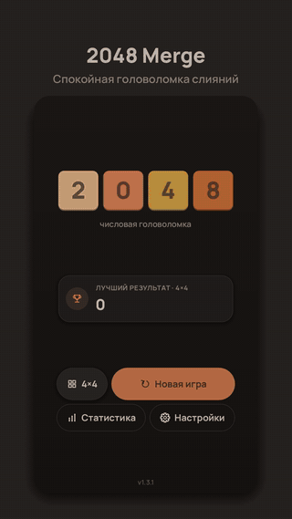

  

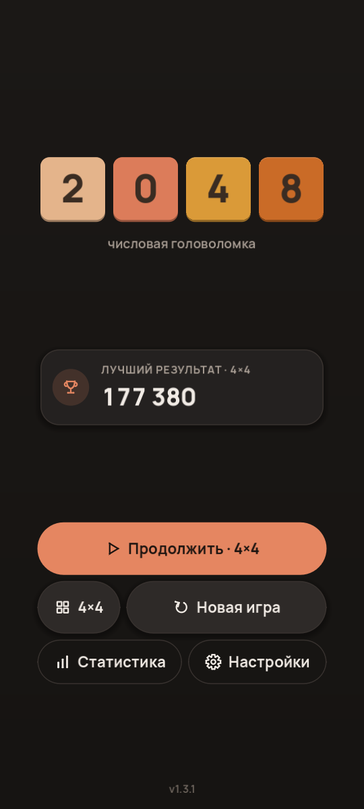 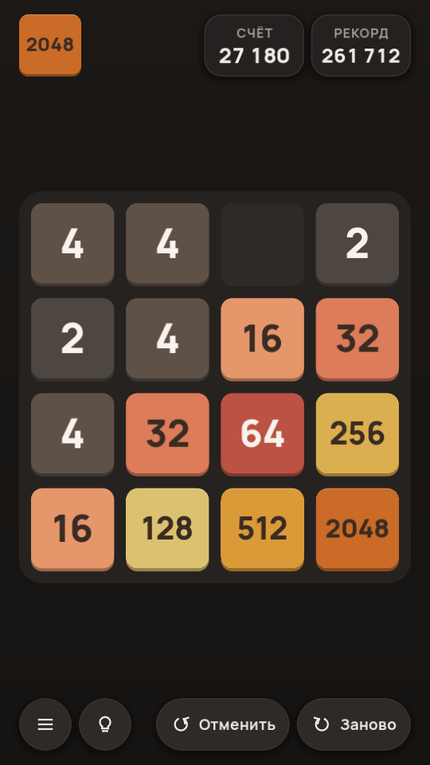 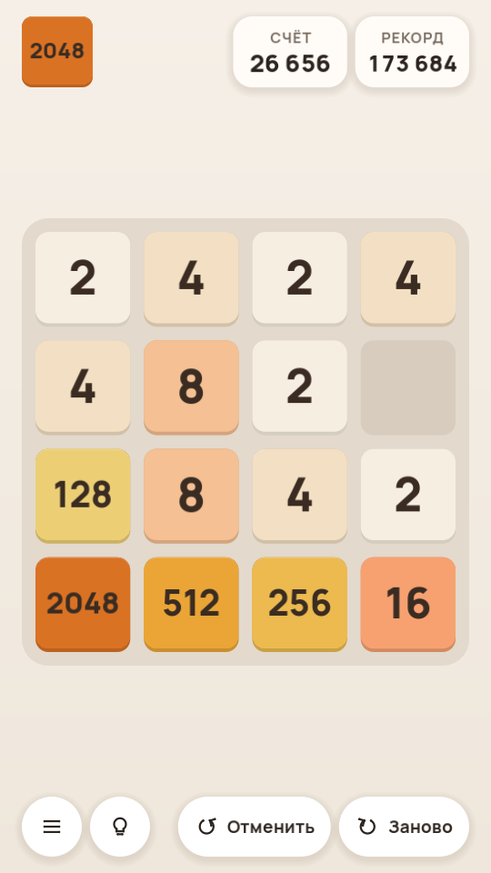 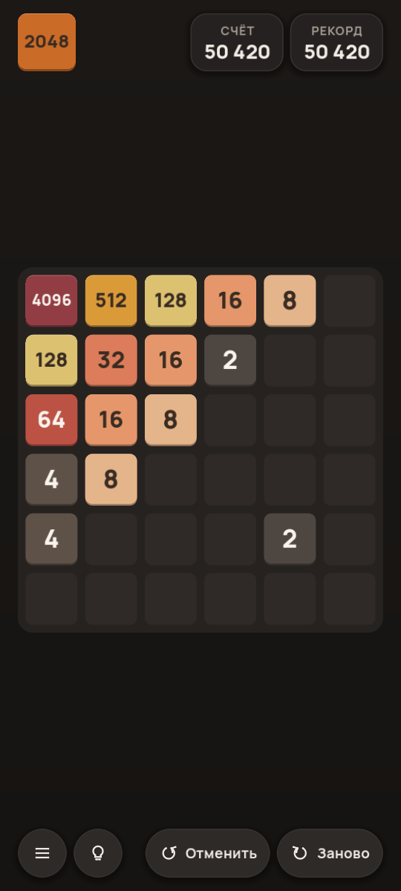

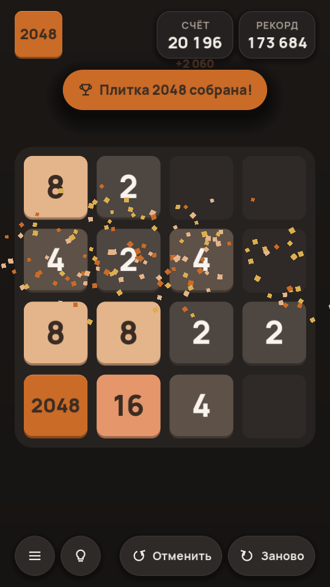 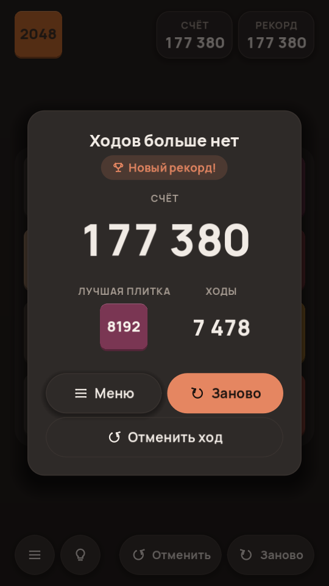 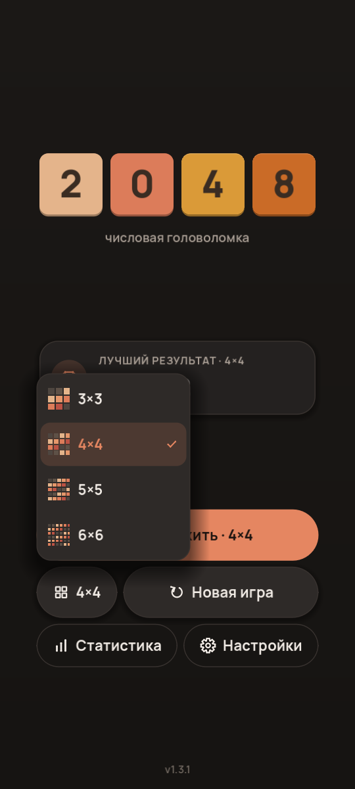 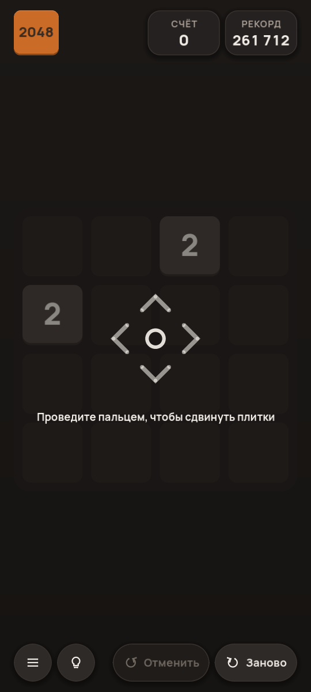

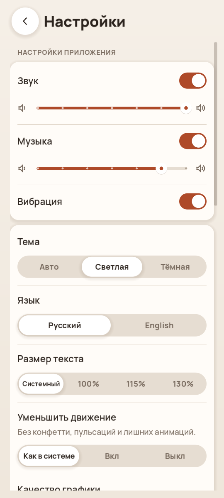 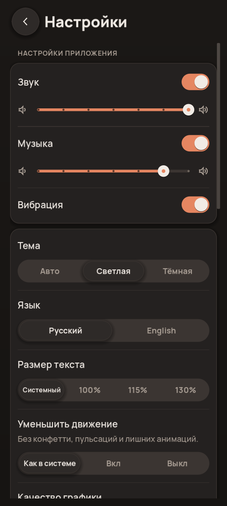 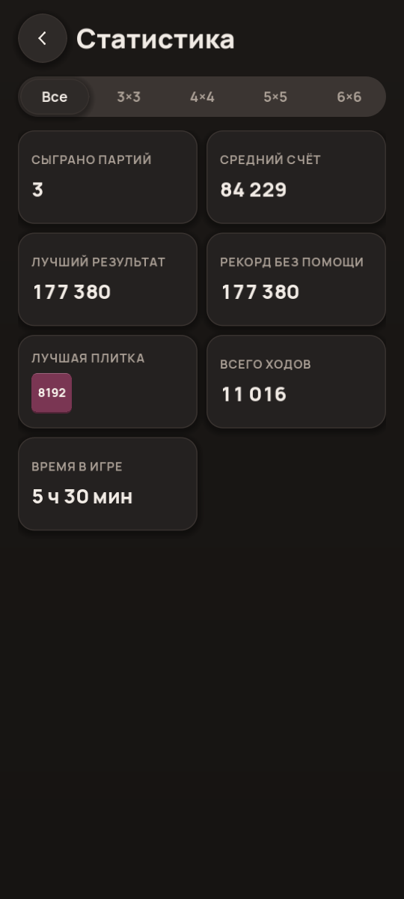 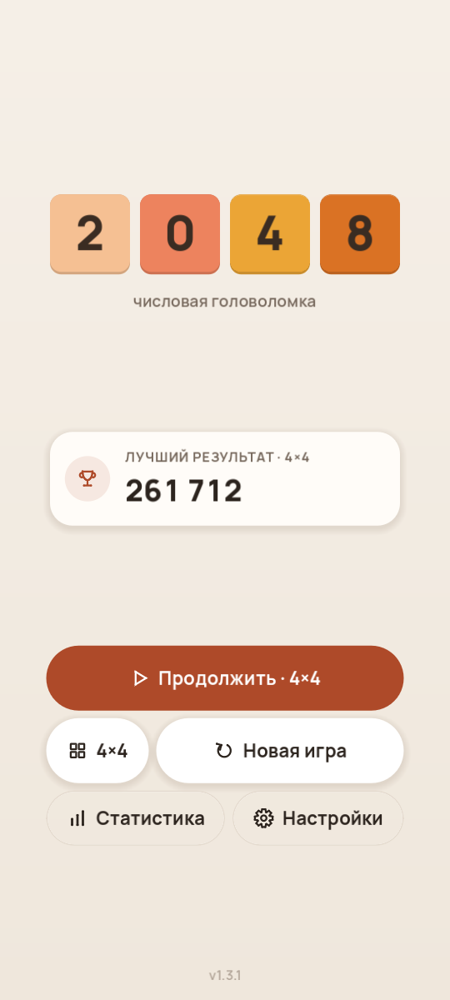

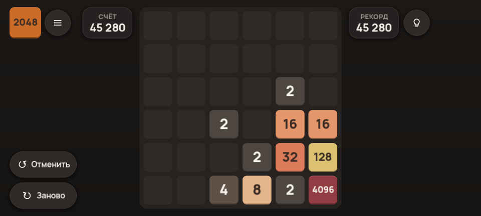

Screenshots from real games played by the hint engine / Скриншоты с настоящих партий, сыгранных движком подсказок

---

Copyright © 2026 Lev Burmistrov (Mahiron-hq)

